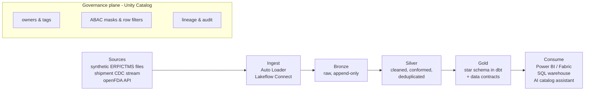

# Clinical Supply Lakehouse

**A governed, production-style lakehouse for a pharma clinical-supply chain — built on Azure Databricks, Delta Lake, Unity Catalog, dbt and Airflow.**


> All data in this project is **synthetic** (generated with Faker) or **public** (openFDA). No real patient or company data is used.

---

## The problem

A clinical-trial sponsor ships investigational drug kits to trial sites around the world. Operations needs to know — reliably and on time — which sites are at risk of running out, which shipments broke temperature limits, and how adverse-event reports relate to the drugs supplied.

The data is sensitive: patient records are PII/PHI, so every table needs an owner, classification, access rules and an audit trail. **This project shows how to build that platform so it is reliable, observable and governed by design — not as an afterthought.**

## Architecture



Two planes run underneath every stage:
- **Delivery:** Git → GitHub Actions → Databricks Asset Bundles (dev → test → prod), orchestrated by Lakeflow Jobs / Airflow.
- **Governance:** Unity Catalog ownership, classification tags, attribute-based masking, column-level lineage and audit via system tables.

## What this project demonstrates

| Area | How |
| --- | --- |
| Reliability | Idempotent Delta `MERGE`, checkpointed streaming, safe backfills |
| Data quality | Pipeline expectations, dbt tests, quarantine tables, data contracts enforced in CI |
| Governance | Unity Catalog owners, PII/PHI tags, ABAC column masks, lineage, audit queries |
| Security | Group-based least-privilege grants, secrets never in code |
| Engineering | Python package with tests, linting, CI on every pull request, IaC-style deployment |
| Cost & performance | Liquid clustering, serverless vs classic compute decisions, cost dashboard from `system.billing` |

## Repository layout

```
├── src/clinical_supply/   # Python package: shared transforms, PII utilities, quality checks
├── data_generator/        # Synthetic data generator (Faker)
├── pipelines/             # Lakeflow declarative pipelines (Bronze → Silver)
├── dbt/                   # Gold-layer models, tests and docs
├── contracts/             # Data contracts for Gold tables (YAML)
├── governance/            # Unity Catalog grants, tags and masking policies as code
├── orchestration/         # Airflow DAGs (local Docker stack)
├── tests/                 # pytest unit tests
├── docs/adr/              # Architecture decision records
├── scripts/               # Tooling (e.g. contract validation)
├── databricks.yml         # Databricks Asset Bundle
└── .github/workflows/     # CI: lint, test, validate contracts
```

## Quick start

This project uses [uv](https://docs.astral.sh/uv/) for Python, dependencies and the lock file.

```bash
# 1. Install Python 3.11 and all dependencies (creates .venv from uv.lock)
uv sync

# 2. Generate synthetic data locally
uv run python -m data_generator.generate --patients 1000 --out data/raw

# 3. Run tests and checks
uv run ruff check .
uv run pytest
uv run python scripts/validate_contracts.py
```

## Roadmap

- [x] **Phase 1** — Engineering foundations: package, tests, CI, synthetic data, first data contract
- [ ] **Phase 2** — PySpark + Delta Lake: incremental loads with `MERGE` and change data feed
- [ ] **Phase 3** — Azure Databricks medallion pipeline deployed with Asset Bundles
- [ ] **Phase 4** — dbt Gold models with contracts; Airflow orchestration
- [ ] **Phase 5** — Governance: PII tagging, ABAC masks, lineage, audit dashboard
- [ ] **Phase 6** — Fabric semantic model + AI "ask the catalog" assistant

## Architecture decisions

See [`docs/adr/`](docs/adr/) for the reasoning behind key choices.

## Author

**Vishnu** — Data engineer with 10+ years across pharma, retail, healthcare and financial services.
